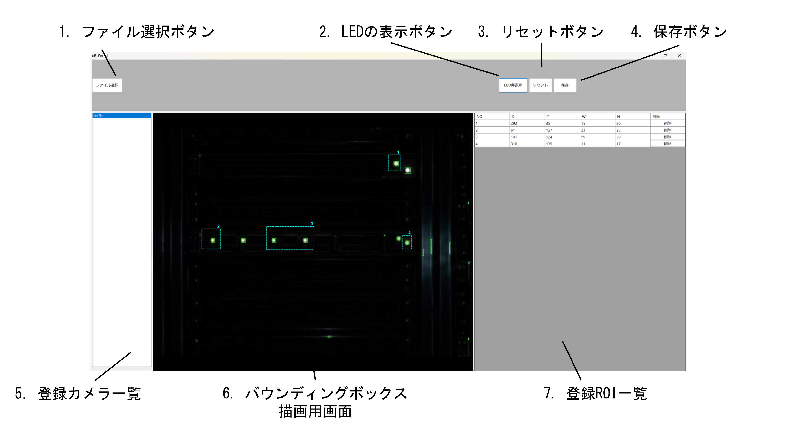
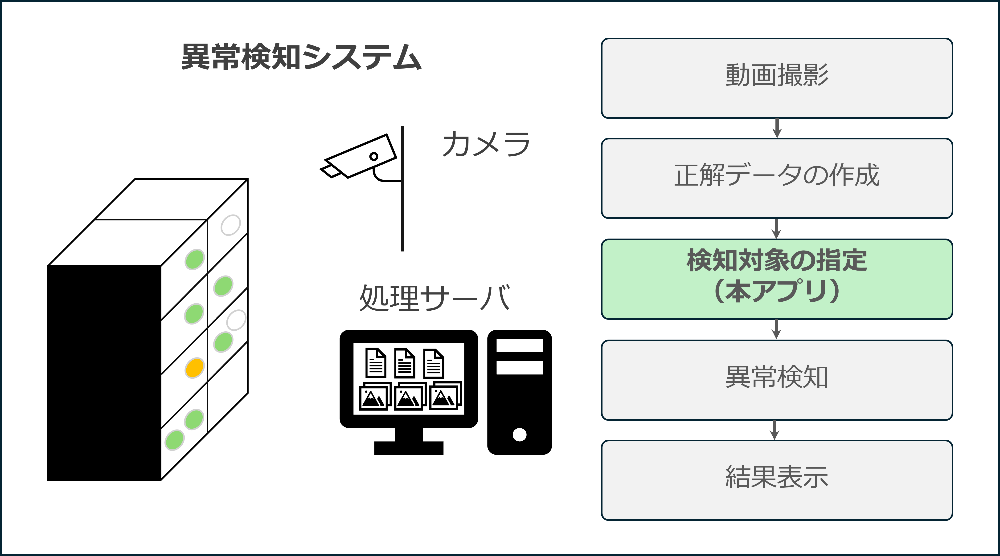

# DrawingROIApp

カメラ画像上で「検知対象の領域（ROI：Region Of Interest）」を指定・保存する Windows Forms アプリケーションです．
LED の点灯状態（常時点灯・点滅・消灯）と色を監視して異常を検知するシステムの一部として，検知領域を設定する役割を担います．

 

## 背景と目的

データセンタのサーバ機器の異常検知では，カメラ映像からLED（Light Emitting Diode）を抽出する処理と，抽出したLEDの状態を取得する処理が必要になります．
LEDの抽出処理では，LED 1個ごとに，それを囲む矩形（バウンディングボックス．以下 BBOX）の位置とサイズを求めます．
しかし，LEDを抽出する処理において，サーバやLANケーブルの表面から反射した光をLEDと誤検出する課題がありました．この誤検出を自動的に除外することが困難であったため，人の手で検知対象を選択する機能を追加することにしました．

## 本アプリの概要

本アプリは，システムが自動抽出した LED の候補位置を画像上に重ねて表示し，その中から監視したい領域をマウス操作で指定できるようにしたものです．指定した領域は座標ファイルとして保存され，後続の異常検知処理が読み込んで使用します．

## 開発の進め方

1. 設計
本アプリケーションの開発目的，UI構成案，必要な機能まとめた機能定義書を作成し，担当の方に相談しました．検知領域を直感的に決められるよう，入力方法はマウス操作としました．要件を満たしているとの確認を得たうえで，早く形になったものを提供してほしいとの要望を受けました．
2. 開発
GUI のレイアウトは Visual Studio で自分で作成し，機能定義書を生成 AI（Claude Code）に読み込ませて，機能の実装を進めました．
3. テスト
ダミーデータを用いて，次の項目の動作を確認しました．
   - 登録カメラの切り替え
   - データの読み込み・出力
   - BBOX の描画機能


## 工夫した点

- ズーム時のマウス位置の維持： 拡大・縮小してもカーソル下の画像位置が動かないよう，表示オフセットを再計算する仕組みを入れました．
- 画像座標での保存：ROI は拡大率や表示位置に依存しない画像上の座標で保存するため，後続の処理でそのまま使うことができます．


## 主な機能

- 登録カメラの一覧表示と，カメラごとの画像表示
- マウスのドラッグによる ROI の描画（番号付きで画像上に表示）
- システムが抽出した LED の BBOX の重ね表示・非表示の切り替え
- マウスホイールによる画像の拡大・縮小（カーソル位置を基準にズーム）
- ROI の一覧表示（座標・サイズ），個別削除，全削除
- ROI のファイル保存と，次回起動時の自動読み込み

## 使用技術

- C# / .NET 9.0
- Windows Forms

## システム内での位置づけ



1. 動画の撮影
2. 正解データの作成（LEDの抽出・状態の定義）
3. **検知領域指定（本アプリ）**
4. 異常検知
5. 結果表示

## 動かし方

docsにあるROIアプリケーションのマニュアル.pdfを確認してください．

### 動作環境

- Windows
- .NET 9 SDK（ビルドする場合）または .NET 9 Desktop Runtime

### 手順

```
git clone https://github.com/hanaoYellow/AnomalyDetection_ROI_DrawingApp.git
cd AnomalyDetection_ROI_DrawingApp
dotnet run
```

または，ビルド済みの `bin/Debug/net9.0-windows/DrawingROIApp.exe` を実行してください．

### サンプルデータ（Data フォルダ）

動作確認用のデータをリポジトリ直下の `Data` フォルダに同梱しています．アプリは起動時にここから読み込みます．

```
Data/
├─ settings/
│   ├─ setting-camera.txt     登録されているカメラ一覧（IPアドレス=ラベル）
│   └─ roi/                   ROI の保存先
│       └─ カメラ1_roi.txt     カメラ1に設定した ROI
└─ sample/
    ├─ average-template_192,168,0,11-4.jpg   カメラ1の表示用の平均画像
    └─ 192,168,0,11_Combined_4.txt           カメラ1の抽出済み LED の BBOX 座標
```

- ROI は `Data/settings/roi/<カメラ名>_roi.txt` に，1 行 1 ROI の `X,Y,W,H` 形式で保存されます．（単位px）
  - `X`：ROIの左上の x 座標（画像左端からの距離）
  - `Y`：ROIの左上の y 座標（画像上端からの距離）
  - `W`：ROIの幅
  - `H`：ROIの高さ
  - 例：`120,80,30,30` は，左上が (120, 80) で幅 30・高さ 30 の矩形を表しています．
- 保存すると `Data` 内のファイルが更新されます．

## 操作方法

用語：**ROI** = 検知対象の領域，**BBOX** = LED を囲む矩形（バウンディングボックス）

| 操作 | 説明 |
| --- | --- |
| 登録カメラ一覧から選択 | そのカメラの画像を表示し，保存済みの ROI があれば読み込む |
| 画像上でドラッグ | ROI を描画する |
| マウスホイール | 画像を拡大・縮小する |
| LEDの表示 ボタン | 抽出済み LED の BBOX（緑）の表示・非表示を切り替える |
| 登録 ROI 一覧の削除ボタン | 選択した ROI を削除する |
| リセット ボタン | 描画済みの ROI をすべて削除する（確認ダイアログあり） |
| 保存 ボタン | ROI の座標をファイルに保存する |
| ファイル選択 ボタン | 任意の画像ファイルを手動で選んで表示する（動作確認用） |

画像上の表示：
- ROI：シアンの破線（番号付き）
- LED：緑の実線
